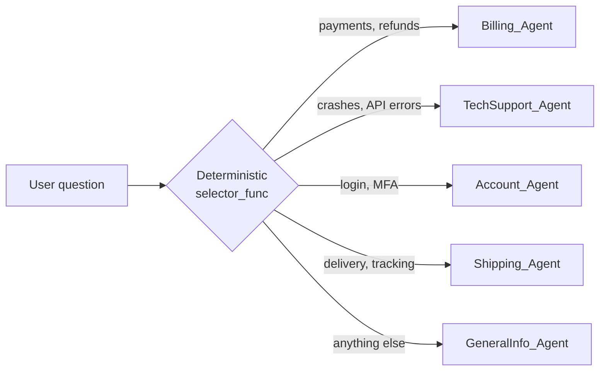

# 🤖 Multi-Agent Customer Support System (AutoGen v0.4)

An enterprise-ready, multi-agent customer support system built with **Streamlit** and **AutoGen v0.4 (`autogen-agentchat`)**. The application dynamically routes user queries to specialized support agents using a deterministic routing engine.

---

## 🌟 Key Features

* **Multi-Agent Specialist Architecture**:
  * 💳 **Billing_Agent**: Handles payments, refunds, subscription double charges, and invoices.
  * 🛠️ **TechSupport_Agent**: Handles platform crashes, 500 server errors, API debugging, and code issues.
  * 🔐 **Account_Agent**: Handles MFA/2FA resets, login issues, password recovery, and account security.
  * 📦 **Shipping_Agent**: Handles physical delivery costs, package tracking, and courier logistics.
  * ℹ️ **GeneralInfo_Agent**: Fallback specialist for AI news, company FAQs, and general queries.
* **Deterministic Selector Routing**: Uses custom AutoGen `selector_func` logic to eliminate LLM speaker selection retries ("Model failed to select a speaker after 3") and guarantee low-latency routing.
* **Modern Dark UI**: Features high-contrast dark themes with explicit specialist scope descriptions and a high-visibility white chat input box.
* **Isolated Turn Execution**: Guarantees independent evaluation per user request to prevent conversation context leakage across turns.

---

## 📁 Project Structure

```text
├── Customer_Support_System_Autogen.py   # Main Streamlit & AutoGen application
├── .env                                 # Environment file containing OPENAI_API_KEY
├── requirements.txt                     # Project dependencies
└── README.md                            # Documentation```

---

## 🧭 How routing works



AutoGen's default `SelectorGroupChat` asks the LLM to choose the next speaker, which sometimes fails with *"Model failed to select a speaker after 3 attempts"*. A custom `selector_func` routes on keywords first, so every query reaches exactly one specialist with no retries and lower latency.

---

## 🚀 Setup & Run

```bash
git clone https://github.com/sathiya-29/Customer_Support_System_Autogen.git
cd Customer_Support_System_Autogen
python -m venv .venv && source .venv/bin/activate   # Windows: .venv\Scripts\activate
pip install -r requirements.txt
cp .env.example .env    # then add your OpenAI key
streamlit run Customer_Support_System_Autogen.py
```

## 💬 Try these

- "I was charged twice for my subscription this month."
- "The API returns a 500 error when I upload a file."
- "I lost my phone and can't pass 2FA."
- "Where is my package? It's been 6 days."
